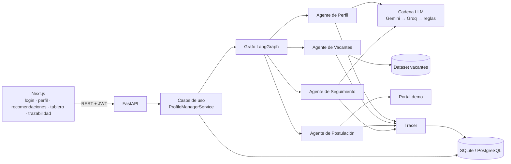
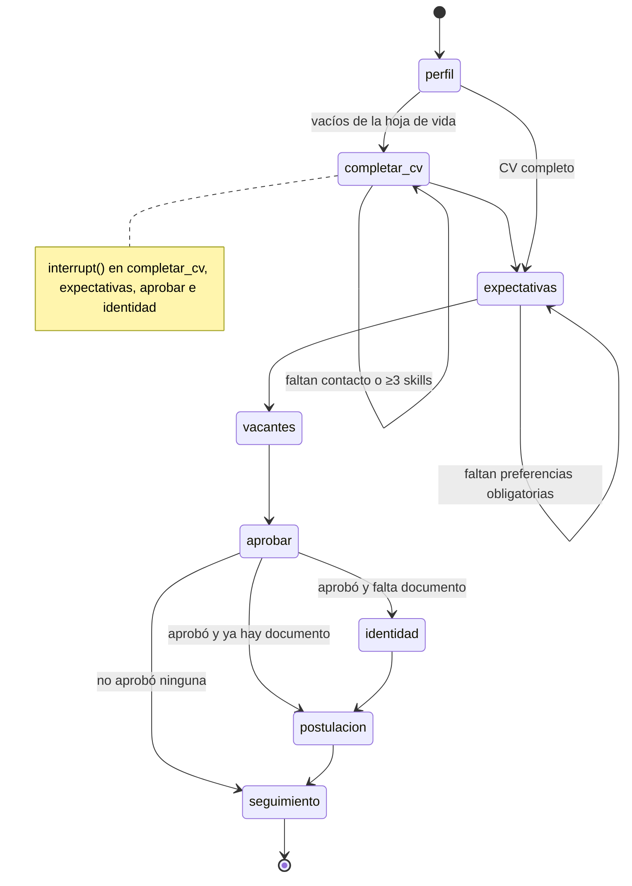

# Arquitectura

## Vista general

## Grafo de agentes

El botón **Simular días** (fuera del grafo) avanza un reloj de demo: el portal simulado cambia estados
(postulado → en revisión → entrevista/descartado) y se ejecuta nuevamente el Agente de Seguimiento.

**Edición del perfil:** `PUT /api/profile` guarda los cambios (protegidos ante un CV nuevo) y, si el grafo
está en pausa, usa `update_state(as_node=…)` para reanudar desde el paso anterior: por ejemplo, editar
habilidades en la etapa de recomendaciones vuelve a ejecutar al Agente de Vacantes.

## Capas (Clean Architecture ligera)

| Capa | Carpeta | Depende de |
|---|---|---|
| Dominio | `app/domain` | nada (Pydantic) |
| Agentes | `app/agents` | dominio, infraestructura (por inyección) |
| Aplicación | `app/application` | agentes, dominio, repositorio |
| Infraestructura | `app/infrastructure` | dominio |
| API | `app/api` | aplicación |

Las reglas de negocio (completitud, scoring, simulación, recordatorios) son funciones puras en `domain/`
y se prueban sin BD ni IA.

## Matching explicable

Principios: **lo declarado es verdad** (una habilidad declarada cuenta completa; "demostrada" es solo
informativa) y **no cumplir todo no descarta**: las brechas bajan el puntaje y se guardan en la postulación
para que el Agente de Seguimiento genere un **plan de preparación**.

1. **Filtros duros (solo condiciones del candidato):** ciudad/modalidad y reubicación, salario mínimo
   (−15%), jornada y tipo de vinculación. Además, relevancia mínima: si no tiene ninguna habilidad técnica
   pedida, solo se recomienda si el cargo coincide del todo con lo que busca.
2. **Puntaje 0–100:** habilidades obligatorias 35 · deseables 8 · transversales 2 · cargo 15 · nivel de
   experiencia 12 · formación 5 · salario 8 · modalidad 10 · sector 5. Si la vacante no pide deseables,
   transversales o formación, ese componente es "No aplica" y no penaliza.
   - Nivel de habilidad menor al pedido: 0.75 (un nivel) o 0.5 (dos). Sin nivel declarado: completo +
     "confirma tu nivel".
   - Idioma MCER: misma o mayor = 1, un subnivel abajo (B1 vs B2) = 0.75, dos = 0.25; pendiente = 0.5.
   - Nivel de experiencia y formación por debajo bajan el puntaje, nunca descartan.
3. **Umbral 45**, máximo 10, desempate por fecha. Los descartes por puntaje muestran sus brechas principales.
4. **Brechas → Seguimiento:** cada recomendación trae `gaps` (habilidad, nivel, idioma, formación,
   experiencia, viajes). Al postular viajan en la evidencia y el Seguimiento crea "Plan de preparación".

## Trazabilidad

Cada agente registra `TraceEvent{agente, acción, motivo, detalles, modo (llm|rules|human|system),
proveedor, duración, día simulado}`. El panel los muestra como línea de tiempo filtrable.

## Seguridad

| Riesgo (OWASP) | Control |
|---|---|
| A01 Control de acceso | JWT obligatorio; cada consulta filtra por `user_id` del token |
| A02 Fallas criptográficas | PBKDF2-SHA256 (200k iteraciones) + sal; JWT HS256 con secreto en `.env` |
| A03 Inyección | ORM con parámetros; Pydantic; lista blanca de campos en respuestas; límites de longitud |
| A04 Diseño inseguro | Human-in-the-loop antes de postular; evidencia con hash SHA-256 |
| A05 Configuración | CORS restringido; advertencia si JWT_SECRET es el de ejemplo |
| A07 Autenticación | Rate limiting en login/registro; mensajes de error genéricos |
| A09 Logging | Logs con ids y acciones, sin contenido del CV ni datos personales |
| Archivos | Solo PDF/TXT, máx. 5 MB, verificación de cabecera `%PDF`, máx. 10 páginas |
